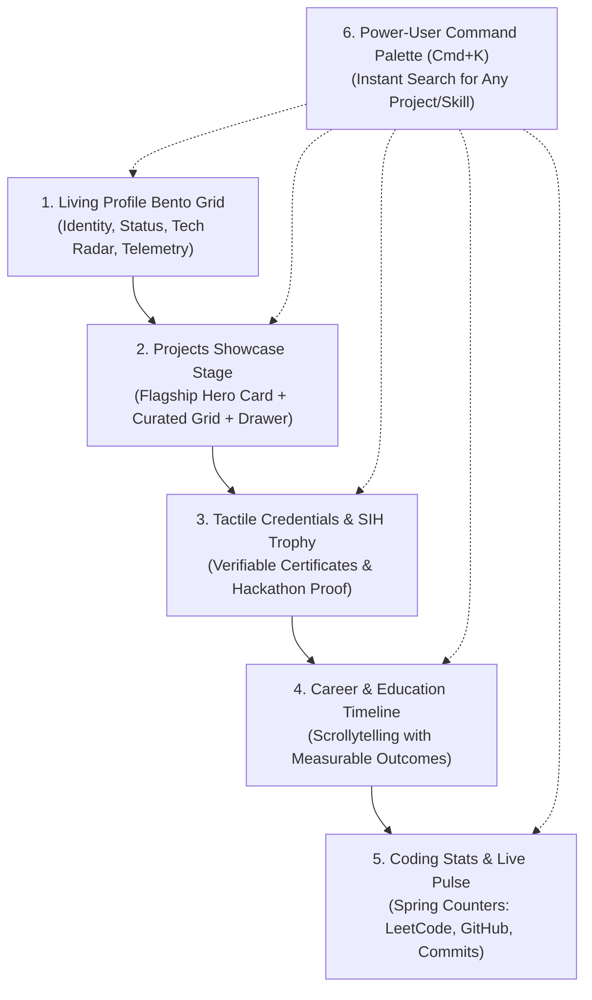

# Frontend Architecture, Design System & Master Implementation Specification
> **Target:** Anurag.dev Personal Portfolio & Engineering Workspace  
> **Repository:** `d:/projects/personal_portfolio`  
> **Status:** Approved Blueprint — Ready for Phased Implementation  
> **Version:** 2.0 (Bespoke Human-Crafted Aesthetic & Softer Contrast)

---

## 1. Executive Vision & Core Principles

### The Goal
Transform the portfolio from a conventional card-grid catalog into an **award-winning, elite engineering workspace**. The interface must achieve two simultaneous objectives:
1. **Instant Information Findability:** Tech leads, recruiters, and clients can locate credentials, contact channels, live demos, and technical depth in seconds without hunting.
2. **Visual Wonder & Architectural Craftsmanship:** The experience immediately conveys high-calibre systems engineering through fluid responsiveness, tactile micro-interactions, and intentional visual hierarchy.

### The "Anti-AI" Design Philosophy
Generic AI-generated frontends (e.g., v0 / Lovable templates) suffer from recognizable tropes that undermine credibility:
- *What we reject:* Cliché purple/cyan neon blobs, centered corporate buzzwords ("Crafting digital futures"), monotonous 3-column card grids where every section looks identical, and fake progress bars.
- *What we build:* **Architectural dignity.** Authentic developer identity, living telemetry, asymmetric bento layouts, cross-linked skill-to-project relationships, and tactile elevation layers that feel designed by a senior product engineer.

### The Softer Contrast Philosophy
Avoid harsh pitch-black backgrounds paired with blinding pure white text (`#000000` vs `#ffffff`), and avoid jarring neon borders.
- **Deep Muted Surfaces:** Obsidian, zinc, and warm charcoal slate foundations (`#080b11`, `#0d131f`, `#121a2b`).
- **Subtle Hairline Borders:** Semi-transparent borders (`rgba(255, 255, 255, 0.08)` to `rgba(255, 255, 255, 0.12)`) that reveal soft accent highlights upon hover.
- **Harmonious Typography Contrast:** Luminous off-white primary headings (`#f1f5f9` / `#e2e8f0`) with warm, legible secondary text (`#94a3b8` / `#64748b`), passing WCAG AA without visual fatigue.

---

## 2. Preserved Workspace Features (Non-Negotiable Core)

The established desktop-OS / IDE paradigm is a central differentiator of this portfolio and **will remain fully intact and operational**:

### 1. The Global TopBar (`TopBar.tsx`)
- **Window Controls (Traffic Lights):**
  - **Red Dot:** Clean window shutdown with state reset.
  - **Yellow Dot:** Minimizes workspace into a floating bottom recovery dock with glowing pulse.
  - **Green Dot:** Toggles native fullscreen.
- **Brand Identity:** `Anurag.dev` monogram with active route indicator.
- **System Diagnostics (`/readme`):** Direct link to hardware diagnostic / architecture documentation.
- **Interactive Resume (`/resume`):** Instant link to full-page print/view resume.
- **Dedicated Agent App Gateway:** Pulsing pill button launching the autonomous agent website (`cortex-anurag.vercel.app`).
- **Direct Contact Button:** Triggers smooth scroll or modal channel to `#contact`.
- **Theme & 3D Background Selectors:** Real-time runtime color theme switcher (5 themes) and Three.js canvas selector.

### 2. The Resizable Workspace Sidebar (`ResizableSidebar.tsx` & `Sidebar.tsx`)
- **Drag-to-Resize Physics:** Smooth dragging between `240px` and `480px` with persistent user width in `localStorage`.
- **Snap Collapse:** Automatically snaps to compact 88px rail below `180px` or via toggle button.
- **Sidebar Profile:** Compact user badge with avatar, status ping, and role.
- **Interactive Table of Contents:** Scroll-spy linked section list reflecting current viewport position with keyboard navigation support.

### 3. Smooth Scroll Engine (`ScrollContainer.tsx` & `useScrollSpy.ts`)
- Vertical smooth-scrolling section container with custom low-profile scrollbar and side-dot indicator (`ScrollIndicator.tsx`).
- Deep-linking support via URL slugs (e.g. `/portfolio/projects`, `/portfolio/experience`).

### 4. Boot Sequence ("Quiet Reveal")
- Minimal luxury monogram splash (`<AB />`) in [BootScreen.tsx](file:///d:/projects/personal_portfolio/client/src/boot/components/BootScreen.tsx) with instant skip key and `sessionStorage` returning-visitor bypass.

---

## 3. Design System & Softer Contrast Architecture

### Semantic Elevation Hierarchy (4 Layers)
Instead of flat 1-dimensional cards, content is organized into visual elevation tiers:

```
┌─────────────────────────────────────────────────────────────┐
│ Surface 0: Background Canvas & 3D Scene (#080b11)           │
│   ┌─────────────────────────────────────────────────────────┐   │
│   │ Surface 1: Workspace Shell & TopBar/Sidebar (#0d131f)   │   │
│   │   ┌─────────────────────────────────────────────────────┐   │   │
│   │   │ Surface 2: Bento Cards & Content Modules (#121a2b)  │   │   │
│   │   │   ┌─────────────────────────────────────────────────┐   │   │   │
│   │   │   │ Surface 3: Floating Drawers, Modals, Cmd+K      │   │   │   │
│   │   │   └─────────────────────────────────────────────────┘   │   │   │
│   │   └─────────────────────────────────────────────────────┘   │   │
│   └─────────────────────────────────────────────────────────┘   │
└─────────────────────────────────────────────────────────────┘
```

| Token | Role | Obsidian (Default Dark) | Ember (Warm Dark) |
|---|---|---|---|
| `--surface-0` | Viewport Canvas / Scene | `#06090e` | `#0a0805` |
| `--surface-1` | OS Shell / Sidebar Base | `#0b1018` | `#130f0a` |
| `--surface-2` | Interactive Bento / Cards | `#111824` | `#1c160f` |
| `--surface-3` | Overlays, Modals, Cmd+K | `#182234` | `#261e15` |
| `--border-subtle`| Baseline Border | `rgba(255,255,255,0.07)` | `rgba(245,158,11,0.12)` |
| `--border-hover` | Proximity Accent Border | `rgba(52,211,153,0.35)` | `rgba(245,158,11,0.40)` |
| `--text-primary` | Main Headings & Titles | `#f1f5f9` (Soft luminous) | `#fef3c7` (Warm cream) |
| `--text-muted`   | Descriptions & Labels | `#8b9bb4` (Balanced slate) | `#a8927e` (Soft amber gray) |

### Dual-Font Typography System
* **Primary Reading & Display (Inter):** Headlines, titles, storytelling copy, card descriptions. Clean, modern, highly legible.
* **Technical Accent & Telemetry (Geist Mono):** Status badges, statistics, code snippets, dates, Git hashes, keyboard shortcut hints.
* **Typographic Scale & Weight Rules:**
  - Hero Display: `text-2xl sm:text-3xl md:text-4xl font-bold tracking-tight`
  - Section Headers: `text-xl sm:text-2xl font-bold tracking-tight`
  - Card Titles: `text-base sm:text-lg font-semibold tracking-tight`
  - Body Text: `text-sm sm:text-base font-normal leading-relaxed text-muted-foreground`
  - Micro-Badges / Telemetry: `text-[11px] sm:text-xs font-mono font-medium tracking-wide`
  - **Zero instances of `font-black` (900) or sub-readable `text-[7px]-text-[9px]`.**

---

## 4. Section-by-Section Architectural Specifications



---

### Section 1: The Living Profile Bento Grid (`ProfileModule`)
Transforms the landing section into an asymmetrical, information-dense 12-column Bento Grid:

1. **Tile 1 — Identity & Purpose (Span: 7 cols desktop, 12 cols mobile):**
   * Monogram badge `<AB />` + Name: **Anurag Basuri**
   * Role: *Full Stack Engineer & AI Systems Developer*
   * Real-time availability indicator:
     `🟢 Open to Full-Stack & AI Roles — Available Immediately`
   * Refined personal statement (2 lines, non-cliché, focused on high-performance web systems and AI integration).
2. **Tile 2 — Interactive Tech Stack Radar (Span: 5 cols desktop, 12 cols mobile):**
   * Interactive pill cluster of core technologies: *TypeScript, Next.js, React, Node.js, PostgreSQL, Redis, LangChain, Tailwind*.
   * **The "Proof of Work" Interaction:** Hovering any skill illuminates every project in the portfolio built with that technology and highlights the matching experience timeline entries.
3. **Tile 3 — Living Telemetry Counters (Span: 4 cols desktop, 6 cols mobile):**
   * `9.0` CGPA — B.Tech Computer Science & Engineering (LPU)
   * `15+` Production & Open-Source Projects
   * `120+` GitHub Stars & Active Commits
   * Smooth spring count-up animation (`useCountUp`) on viewport entry.
4. **Tile 4 — "Currently Building" Pulse (Span: 4 cols desktop, 6 cols mobile):**
   * Live badge: ⚡ *Streaming Video Architecture (StreamFlow) & Autonomous Agent Systems*
   * Last updated commit indicator linking directly to GitHub repo.
5. **Tile 5 — Direct Action Deck (Span: 4 cols desktop, 12 cols mobile):**
   * **1-Click Resume Button:** Direct view/download of verified PDF.
   * **Copy Email Button:** Copies `basurianurag@gmail.com` with tactile ripple and checkmark confirmation.
   * **Quick Social Dock:** Clean icon triggers for GitHub, LinkedIn, X, and LeetCode.

---

### Section 2: Flagship Project Showcase (`ProjectsModule`)
Eliminates the uniform 3-column card monotony by establishing clear project hierarchy:

1. **The Flagship "Hero Project" Card (Full Width):**
   * Premier showcase for Anurag's top full-stack / AI platform (*StreamFlow* or *Personal Portfolio OS*).
   * **Split Architectural Layout:**
     - *Left (50%):* Live responsive interactive preview / video frame with subtle device chrome and direct "Try Live App" CTA.
     - *Right (50%):* Engineering Case Study breakdown:
       - **The Challenge:** Real-world constraint or scalability hurdle.
       - **The Architecture:** Technical stack & system design choices (e.g., WebRTC, Redis pub/sub, Next.js App Router).
       - **Quantifiable Outcome:** Measurable latency, throughput, or capability improvement.
       - **"Inspect Architecture / Code" Drawer Trigger:** Slide-out drawer displaying component architecture or database schema.
2. **Secondary Curated Project Grid (2-Column Asymmetrical Masonry):**
   * High-density cards for remaining projects (*AI Lab*, open-source tools, etc.).
   * Visual tech stack pills with direct GitHub and live deployment links.
3. **Domain Filter Bar:**
   * Filter pills with smooth sliding active background: `All`, `Full-Stack`, `AI & Systems`, `Open Source`.
   * Real-time search filter input with instant matching.

---

### Section 3: Tactile Verifiable Credentials (`Certifications` & `Achievements`)

1. **Certifications Showcase:**
   * Replaces generic cards with **tactile credential cards**.
   * Subtle metallic sheen gradient border that tilts with cursor proximity.
   * Prominent issuer badges (AWS, Coursera, Meta) with credential ID and verified date.
   * 1-Click "Verify Credential" link opening direct external verification sheet.
2. **Smart India Hackathon (SIH 2024) National Finalist Trophy Card:**
   * Featured showcase celebrating Anurag's **Smart India Hackathon 2024 Finalist** achievement.
   * Displays national ranking, issuing body (Government of India), project domain, and team credits.

---

### Section 4: Scrollytelling Career & Education Journey (`ExperienceModule`)

1. **Animated Milestone Line:**
   * Gradient timeline line that dynamically draws itself (`pathLength` Framer Motion animation) as the visitor scrolls down.
2. **Quantifiable Engineering Impact:**
   * Bullet points formatted around technical ownership and quantifiable outcomes (e.g., *"Engineered real-time socket infrastructure reducing state synchronization latency"*).
3. **Interactive Tenure Cards:**
   * Tags for specific technologies introduced during each role.

---

### Section 5: Universal Command Palette (`Cmd+K` / `Ctrl+K`)

A power-user navigation center accessible anywhere via keyboard shortcut or search trigger:
- **Instant Search:** Fuzzy search across all projects, case studies, certifications, and skills.
- **Quick Actions:** Switch active color theme, toggle 3D background, download resume, copy contact info, or ask the AI agent a quick question.
- Fully accessible via keyboard arrows, Enter, and Escape.

---

### Section 6: Adaptive Mobile Architecture

Maintains the IDE workspace metaphor on desktop while providing a native app experience on mobile devices (`< 768px`):
1. **Floating Frosted Bottom Dock (`MobileDock.tsx`):**
   * Replaces the hidden sidebar on mobile with a compact bottom navigation bar with 5 tactile icons (Profile, Projects, Experience, Certs, Agent).
2. **Clean Mobile Header:**
   * Removes non-functional window traffic dots on small viewports to reclaim 60px of vertical reading space.
3. **Mobile Bottom Sheet for AI Agent:**
   * Opens the assistant as a swipeable bottom drawer rather than an overflowing fixed modal.
4. **Touch Device Optimization:**
   * Automatically disables [CustomCursor.tsx](file:///d:/projects/personal_portfolio/client/src/ui/CustomCursor.tsx) and 3D pointer parallax on `(pointer: coarse)` devices to conserve battery and GPU cycles.

---

## 5. Phased Implementation Roadmap

```mermaid
gantt
    title Portfolio Upgrade Execution Roadmap
    dateFormat  X
    axisFormat %d

    section Phase 1: Tokens & Data Layer
    Softer Contrast Tokens & Elevation Layers   :p1_1, 0, 1
    Consolidate Profile Atom (Jotai Cache)      :p1_2, 1, 2

    section Phase 2: Profile Bento Grid
    Bento Grid Layout & Telemetry Cards        :p2_1, 2, 4
    Interactive Tech Stack Radar               :p2_2, 4, 5

    section Phase 3: Project Showcase
    Flagship Hero Project Card & Case Study     :p3_1, 5, 7
    Secondary Curated Grid & Domain Filters    :p3_2, 7, 8

    section Phase 4: Credentials & Journey
    Tactile Verifiable Certificates & SIH Card  :p4_1, 8, 9
    Scrollytelling Experience Timeline         :p4_2, 9, 10

    section Phase 5: Mobile & Command Palette
    MobileDock & Chrome Optimization           :p5_1, 10, 11
    Universal Cmd+K Command Palette            :p5_2, 11, 12
```



### Phase 1: Softer Contrast Tokens & Unified State (Foundation)
* [x] Update `client/src/theme/colors/tokens.ts` with softened obsidian slate, card elevation surfaces, and subtle hairline border values across all themes.
* [x] Add semantic elevation tokens (`--surface-0`, `--surface-1`, `--surface-2`, `--surface-3`, `--border-subtle`) to `globals.css` and `tokens.ts`.
* [x] Create `client/src/api/store/profileAtom.ts` to cache profile and project data across modules and eliminate waterfall network calls.

### Phase 2: Structural Harmony & Architectural Dossier (Section 1)
* [x] Refactor [ProfileModule](file:///d:/projects/personal_portfolio/client/src/modules/profile/index.tsx) into a unified Blueprint Stage Dossier Card matching Section 02 Projects.
* [x] Implement animated spring count-up counters (`useCountUp`) for GPA, systems shipped, and experience.
* [x] Implement the interactive Tech Radar with cross-highlighting to projects.
* [x] Integrate the direct 1-click Resume download and tactile copy-email button.

### Phase 3: Flagship Hero Project & Case Studies (Section 2)
* [x] Build Stage Feature Card featuring split live preview and Problem ➔ Architecture ➔ Impact narrative without fake OS traffic dots.
* [x] Connect project tech tags to the active skill filter state.
* [x] Refactor secondary project cards into curated cards with category filtering tabs.

### Phase 4: Tactile Credentials & Hackathon Proof (Sections 3, 4, 5, 6)
* [x] Redesign [certifications](file:///d:/projects/personal_portfolio/client/src/modules/certifications/index.tsx) with softened contrast and verification badges.
* [x] Build dedicated Smart India Hackathon 2024 National Finalist showcase card in [achievements](file:///d:/projects/personal_portfolio/client/src/modules/achievements/index.tsx).
* [x] Align SectionHeaders across all 9 modules (`// 01` through `// 09` with domain tags matching BootScreen DNA).

### Phase 5: Mobile Dock, Cache Architecture & Polish (Completed)
* [x] Build `MobileDock.tsx` floating frosted navigation bar for screens `< 768px`.
* [x] Disable `CustomCursor` on `pointer: coarse` devices.
* [x] Resolve Next.js 15.5.9 `optimizePackageImports` webpack runtime bug and dev server caching headers.
* [x] Run production build (`npm run build` exiting with code 0 across 18 routes) and live browser inspection.
