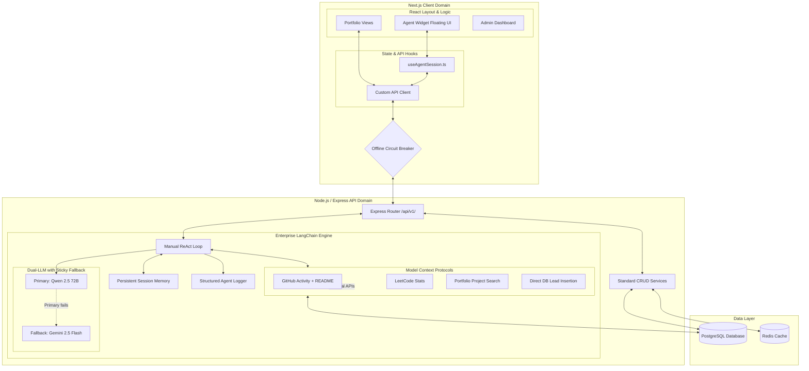

# Anurag.dev — Enterprise Personal Portfolio & Autonomous AI Agent

Anurag.dev is a bleeding-edge, full-stack personal brand platform. It transcends traditional static portfolios by integrating a **fully autonomous LangChain LLM Agent** that serves as a 24/7 personal assistant for visitors. Built on an Express REST API backend with PostgreSQL + Prisma and a highly animated Next.js frontend, this project demonstrates scalability, resilience, and advanced AI integration.

---

## 🏗️ Master System Architecture

Anurag.dev relies on a strictly decoupled architecture, meaning the frontend, backend, database, and AI inference engines can all crash, restart, and scale independently without tearing each other down.



---

## 🧠 Deep Dive: The AI Agent Architecture

Instead of basic chatbot text-in/text-out completions, the Anurag.dev agent operates using the **Model Context Protocol (MCP)** and a **manual ReAct (Reasoning and Acting) loop** with enterprise-grade failover.

### How a Chat Query Works (Step-by-Step)

1. **User Input:** A visitor types *"What React projects have you built? And how many LeetCode questions have you solved?"*
2. **Context Injection (RAG):** The backend pulls Anurag's profile data (Bio, Skills, Job Status) from PostgreSQL and injects it into the `SystemPersona` prompt alongside screen-awareness context (`currentUrl`).
3. **The LLM Loop Begins:** The primary LLM reads the prompt and decides it needs external data. It generates a JSON payload requesting tools: `search_projects("React")` and `get_leetcode_stats()`.
4. **Tool Execution:** The Express backend intercepts these requests and executes them with full observability logging (execution time, output preview, success/failure status).
5. **Final Generation:** Tool outputs are fed back into the LLM for a second pass. The model structures a human-readable Markdown response and returns it to the React UI.

### The Dual-LLM Architecture with Sticky Fallback

The system operates on a **dual-engine core** (`src/modules/agent/core/llm.factory.ts`):

```
┌──────────────────────────────────────────────────────┐
│              LLM Invocation Flow                     │
│                                                      │
│  Request Loop 1:                                     │
│    ┌─────────────┐     ┌──────────────────────┐      │
│    │ HuggingFace │────►│ Success? → Continue  │      │
│    │  (Primary)  │     │ Fail? → Set STICKY   │      │
│    └─────────────┘     │   flag, try Gemini   │      │
│                        └──────────────────────┘      │
│                                                      │
│  Request Loops 2-4:                                  │
│    ┌──────────────────────────────────────────┐      │
│    │ STICKY flag set? → Skip Primary entirely │      │
│    │ Go directly to Gemini (no timeout wait)  │      │
│    └──────────────────────────────────────────┘      │
└──────────────────────────────────────────────────────┘
```

**Key design decisions:**
- **HuggingFace (Qwen 2.5 72B-Instruct)** is the primary LLM — fast, reliable, no rate-limit issues on free-tier.
- **Google Gemini 2.5 Flash** is the fallback — powerful but subject to daily free-tier rate limits.
- **Sticky Fallback**: Once the primary fails within a single request, all subsequent LLM loops in that request skip the primary entirely. This eliminates repeated 30-second timeout penalties.
- **30-Second Timeout**: Every LLM invocation is wrapped in a `Promise.race()` timeout to prevent SDK-level internal retry hangs (Google's SDK retries internally for ~3 minutes by default).

### MCP Tool Registry

| Tool | Description | External API |
|------|-------------|-------------|
| `get_github_activity` | Fetches GitHub profile stats and recent 5 events | `api.github.com` |
| `read_github_readme` | Reads raw README.md from any public repository | `api.github.com` |
| `get_leetcode_stats` | Fetches LeetCode solving stats and ranking | `alfa-leetcode-api.onrender.com` |
| `search_projects` | Searches published portfolio projects by keyword | PostgreSQL (Prisma) |
| `submit_contact_lead` | Inserts a contact lead directly into the database | PostgreSQL (Prisma) |

### Autonomous Navigation

The Agent can trigger client-side routing via `[NAVIGATE:/path]` tokens embedded in its response. The frontend's `useAgentSession` hook intercepts these tokens, executes `router.push()`, and strips the command from the visible message — so the user sees a seamless page transition.

---

## 📊 Structured Observability Logging

The Agent pipeline includes a centralized logging system (`agent.logger.ts`) that provides full visibility into every layer:

```
[2026-03-26 01:58:22] [INFO]  [Agent:SYSTEM] ━━━ New Request ━━━
                              {"sessionId":"abc","llmMode":"dual","primary":"HuggingFace","fallback":"Gemini"}
[2026-03-26 01:58:23] [INFO]  [Agent:LLM]    🧠 Invoking HuggingFace (Qwen2.5-72B-Instruct)
[2026-03-26 01:58:27] [INFO]  [Agent:LLM]    ✅ LLM responded {"durationMs":4600,"hasToolCalls":true}
[2026-03-26 01:58:27] [INFO]  [Agent:TOOL]   ⚡ Executing: get_github_activity
[2026-03-26 01:58:28] [INFO]  [Agent:TOOL]   ✅ get_github_activity completed {"durationMs":875}

[2026-03-26 01:58:52] [INFO]  [Agent:SYSTEM] ━━━ Request Complete ━━━
                              {"usedProvider":"HuggingFace","totalDurationMs":30200,"llmLoops":2}
```

**Log Categories:** `SYSTEM`, `LLM`, `TOOL`, `MEMORY`, `CTRL`  
**Log Levels:** `INFO`, `WARN`, `ERROR`, `DEBUG` (DEBUG only in development)

---

## 🛡️ Error Handling Strategy

Anurag.dev implements a **zero-crash** error handling philosophy. The AI Agent is designed to **never** return an HTTP 500 to the frontend.

### Backend Error Cascade

```
┌────────────────────────────────────────────────────┐
│  Tool Execution Error (e.g., GitHub API down)      │
│  → Caught inside tool → Returns error string       │
│  → LLM reads error → Generates human-friendly msg  │
│  → User sees: "I can't fetch GitHub right now..."   │
└────────────────────────────────────────────────────┘

┌────────────────────────────────────────────────────┐
│  LLM Invocation Error (e.g., API rate limit)       │
│  → Primary fails → Sticky flag set                 │
│  → Fallback LLM invoked → Success                  │
│  → User doesn't notice anything                    │
└────────────────────────────────────────────────────┘

┌────────────────────────────────────────────────────┐
│  Both LLMs Fail (catastrophic)                     │
│  → Controller catches → Returns HTTP 200           │
│  → reply: "I ran into a hiccup..."                 │
│  → Error category logged: RATE_LIMIT / TIMEOUT /   │
│    NETWORK / INTERNAL                              │
└────────────────────────────────────────────────────┘
```

### Frontend Error Isolation

| Layer | Strategy |
|-------|----------|
| **`useAgentSession` hook** | All API errors caught → displayed as a chat bubble. Error never propagates to React tree. |
| **`ApiClientError` handling** | Reads `.message` directly (not Axios-style `.response.data`). Fallback message for network errors. |
| **Global `error.tsx` boundary** | Styled terminal-themed error page with stack trace toggle (dev only) and recovery button. Only triggers for non-Agent rendering crashes. |
| **Circuit Breaker** | After 3 consecutive API failures, portfolio falls back to static JSON. Background health checks resume live API after recovery. |

---

## 🛡️ Frontend Hybrid Strategy (Circuit Breaker)

To guarantee 100% uptime regardless of backend maintenance windows, the frontend wraps API calls in a **Circuit Breaker state machine**:

1. **Online (Closed):** The Next.js app queries the Express API normally.
2. **Tripped (Open):** After 3 consecutive HTTP timeouts or 500 errors, the frontend "trips" its breaker.
3. **Offline Mode:** The application seamlessly falls back to reading static JSON files (`client/src/api/fallback/`) containing last-known-good data.
4. **Recovery (Half-Open):** A background job pings the backend `health` route every 60 seconds. Once healthy, the breaker closes and live API requests resume.

The visitor never sees a white error screen.

---

## 💻 Technical Stack

| Layer | Technology |
|---|---|
| **Frontend** | Next.js 16, React 19, Tailwind CSS v4, Framer Motion |
| **Backend** | Express, TypeScript, Prisma ORM, Zod validation |
| **Database** | PostgreSQL 14+ |
| **Cache** | Redis 6+ |
| **AI Primary** | HuggingFace Inference API (Qwen 2.5 72B-Instruct) via `@langchain/openai` |
| **AI Fallback** | Google Gemini 2.5 Flash via `@langchain/google-genai` |
| **Auth** | JWT (access + refresh tokens), bcrypt, account lockout |
| **Media** | Cloudinary (image/file uploads via Multer) |
| **Observability** | Custom structured logger with timestamped categories |

---

## ⚙️ Environment Variables

### Backend (`server/.env`)

| Variable | Required | Description |
|----------|----------|-------------|
| `NODE_ENV` | ✓ | `development` or `production` |
| `PORT` | ✓ | Backend port (default: `4000`) |
| `DATABASE_URL` | ✓ | PostgreSQL connection string |
| `REDIS_HOST` / `REDIS_PORT` | ○ | Redis instance for route caching |
| `JWT_SECRET` | ✓ | 64-char symmetric key for access tokens |
| `JWT_REFRESH_SECRET` | ✓ | Symmetric key for refresh tokens |
| `CLOUDINARY_CLOUD_NAME` | ✓ | Cloudinary cloud name |
| `CLOUDINARY_API_KEY` | ✓ | Cloudinary API key |
| `CLOUDINARY_API_SECRET` | ✓ | Cloudinary API secret |
| `HF_TOKEN` | ✓ | HuggingFace access token (primary LLM) |
| `GEMINI_API_KEY` | ○ | Google Gemini API key (fallback LLM) |
| `AI_PROVIDER` | ○ | Force-select provider (legacy, defaults to `gemini`) |
| `GITHUB_TOKEN` | ○ | GitHub PAT for elevated API rate limits |

### Frontend (`client/.env.local`)

| Variable | Required | Description |
|----------|----------|-------------|
| `NEXT_PUBLIC_API_URL` | ✓ | Backend URL (e.g., `http://localhost:4000`) |
| `NEXT_PUBLIC_API_TIMEOUT_MS` | ○ | API timeout in ms (default `5000`; mobile uses a higher floor) |

For production deployments, set `NEXT_PUBLIC_API_URL` to a publicly reachable HTTPS backend URL (not `localhost`).

---

## 🚀 Quick Start

```bash
# 1. Backend
cd server
npm install
cp .env.example .env        # Fill in all variables
npm run db:generate          # Generate Prisma types
npm run db:migrate           # Push schema to PostgreSQL
npm run db:seed              # Seed initial data + admin account
npm run dev                  # → http://localhost:4000

# 2. Frontend
cd ../client
npm install
cp .env.local.example .env.local
npm run dev                  # → http://localhost:3000
```

**Default Admin**: `admin` / `admin123`

---

## 📦 File System Structure

```
personal_portfolio/
├── server/                          # Node.js + Express + Prisma
│   ├── prisma/                      # Schema, migrations, seed
│   └── src/
│       ├── controllers/             # Standard HTTP handlers
│       ├── services/                # Business logic (DB, external APIs)
│       ├── routes/                  # Express routing + API docs
│       ├── schemas/                 # Zod validation schemas
│       ├── middleware/              # Auth, validation, rate limiting
│       ├── config/                  # Environment & app config
│       ├── utils/                   # ApiError, ApiResponse helpers
│       └── modules/
│           └── agent/               # [STANDALONE] AI Agent Engine
│               ├── agent.service.ts     # ReAct loop with sticky fallback
│               ├── agent.controller.ts  # Zero-crash error handling
│               ├── agent.admin.*        # Admin CRUD for sessions
│               ├── core/
│               │   ├── llm.factory.ts   # Dual-LLM singleton init
│               │   ├── agent.logger.ts  # Structured observability
│               │   ├── memory.service.ts# Persistent Prisma sessions
│               │   └── prompts.ts       # System persona
│               ├── tools/               # MCP tool implementations
│               │   ├── github.tool.ts   # GitHub activity + events
│               │   ├── github.repo.tool.ts # README reader
│               │   ├── leetcode.tool.ts # LeetCode stats
│               │   ├── portfolio.tool.ts# Project search
│               │   └── contact.tool.ts  # Lead insertion
│               └── rag/                 # Context retrieval
│
└── client/                          # React + Next.js App Router
    └── src/
        ├── app/                     # Portfolio, Admin, Resume, README
        ├── modules/                 # Feature modules (profile, projects, blog...)
        │   └── agent/               # AI Widget UI
        │       ├── components/      # Chat window, bubbles, loader
        │       ├── hooks/           # useAgentSession (error isolation)
        │       └── types/           # Message interfaces
        ├── layout/                  # App shell (sidebar, scroll, TOC)
        ├── api/                     # API client + circuit breaker + fallback
        ├── lib/                     # Skill icons, routes, utils
        └── boot/                    # Splash animation
```

---

## 🛡️ Production Security

- **Session Isolation:** Conversation history is keyed to randomized browser `sessionIds` — users cannot read or poison other sessions.
- **Input Sanitization:** All user inputs pass through `sanitize-html` before database insertion.
- **DDoS Protection:** `express-rate-limit` restricts Agent chat to 15 messages/minute per IP.
- **JWT Rotation:** 15-minute access tokens with rotated refresh tokens. Account lockout after 3 failed attempts.
- **CORS:** Strict origin allowlisting in production.

---

## 📡 API Documentation

Access full API documentation at `GET /api/v1/docs`.  
Live AI Agent architecture status at `GET /api/v1/docs/agent`.

---

### Author
Designed and Architected by **Anurag Basuri**

## License
This project is licensed under the MIT License - see the [LICENSE](LICENSE) file for details.
